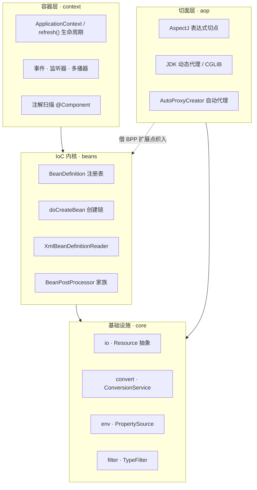
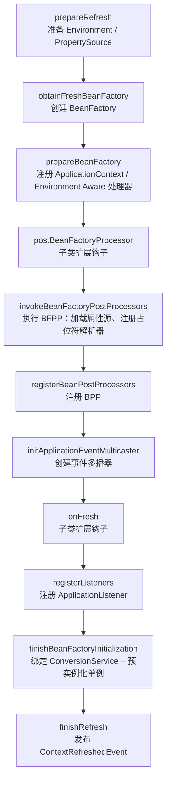
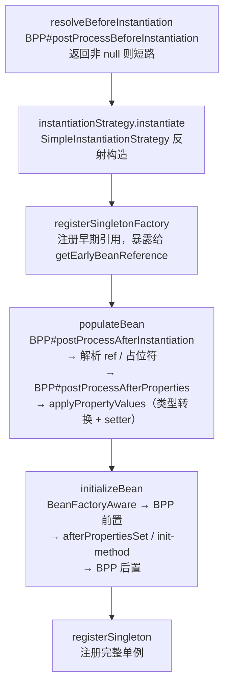

# mini-spring

> 复刻 Spring Framework 的 **IoC 容器**与 **AOP 内核**
>
> **定位声明**：这是一个学习 / 教学型工程，目标是「把 Spring 的核心机制用可读的代码重新实现一遍」，**不是生产可用框架**。
---

## 目录

- [快速开始](#快速开始)
- [架构总览](#架构总览)
- [核心能力清单](#核心能力清单)
- [核心流程解析](#核心流程解析)
- [使用示例](#使用示例)
- [测试清单](#测试清单)
- [目录结构](#目录结构)

---

## 这个项目是什么

**照着 Spring 的包结构，从零实现一个能跑通「XML 配置 → 实例化 → 属性注入 → 后置处理 → 循环依赖 → 事件 → 切面代理」全链路的轻量容器。**

它实现了：

- `Resource` 资源抽象与 `ResourceLoader` 协议解析
- XML 配置的 `BeanDefinition` 解析与注册
- 单例 / 原型作用域、`FactoryBean`、延迟初始化
- 属性注入（`ref` 解引用 + `setter` 反射 + 类型转换）
- **循环依赖**：早期引用（`getEarlyBeanReference`）解法
- **三级后置处理器**：`BeanFactoryPostProcessor` / `BeanPostProcessor` / `InstantiationAwareBeanPostProcessor`
- Aware 回调、`InitializingBean` / `init-method` / `DisposableBean` / `destroy-method` 生命周期
- `@Autowired` / `@Value` / `@Qualifier` 注解注入，`@Component` 包扫描
- `${}` 占位符 + `Environment` / `PropertySource` 体系
- `ApplicationContext` 的 `refresh()` 启动流程与事件机制
- AOP：通知体系、AspectJ 表达式切点、JDK 动态代理 + CGLIB 双代理、**自动代理织入**

它**没有**实现：注解驱动配置（`@Configuration` / `@Bean`）、构造器注入、事务、MVC、Spring Boot 自动装配。

---

## 快速开始

本项目没有可运行的 `main` 应用，**验证方式就是跑测试**。

```bash
# 环境要求：JDK 21、Maven 3.6+
mvn clean test
```

最小使用示例见[使用示例](#使用示例)，测试断言与覆盖范围见[测试清单](#测试清单)。

---

## 架构总览

四个模块自上而下单向依赖，`aop` 通过 `beans` 提供的 `BeanPostProcessor` 扩展点反向织入。



包职责一览：

| 包 | 职责 |
| --- | --- |
| `org.springframework.core.io` | 资源抽象：`Resource`、`ResourceLoader`、`ClassPathResource`、`FileSystemResource`、`UrlResource` |
| `org.springframework.core.convert` | 类型转换：`ConversionService`、`GenericConversionService`、`Converter` / `ConverterFactory` / `GenericConverter` |
| `org.springframework.core.env` | 配置环境：`Environment`、`PropertySource`、`MutablePropertySources` 与 `EnvironmentAware` 注入 |
| `org.springframework.core.filter` | 类型过滤器：`TypeFilter`、`AnnotationTypeFilter` |
| `org.springframework.util` | 工具：`StringValueResolver`（占位符解析器 SPI） |
| `org.springframework.beans.factory` | BeanFactory 接口族、`FactoryBean`、生命周期接口 |
| `org.springframework.beans.factory.support` | 容器核心实现：`AbstractBeanFactory`、`AbstractAutowireCapableBeanFactory`、`DefaultListableBeanFactory`、实例化策略 |
| `org.springframework.beans.factory.config` | `BeanDefinition`、`BeanReference`、BPP 接口族 |
| `org.springframework.beans.factory.xml` | XML 配置解析：`XmlBeanDefinitionReader` |
| `org.springframework.beans.factory.annotation` | 注解注入：`@Autowired` / `@Value` / `@Qualifier` 与 `AutowiredAnnotationPostProcessor` |
| `org.springframework.context` | 容器门面：`ApplicationContext`、Aware 回调、事件模型 |
| `org.springframework.context.support` | 容器实现：`AbstractApplicationContext`、`AbstractXmlApplicationContext`、`ClassPathXmlApplicationContext` |
| `org.springframework.context.annotation` | 注解扫描：`@Component`、`@Scope`、`ClassPathBeanDefinitionScanner` |
| `org.springframework.aop` | 通知与切点抽象：`Advice`、`Pointcut`、`Advisor`、`ClassFilter`、`MethodMatcher` |
| `org.springframework.aop.aspectJ` | AspectJ 表达式切点：`AspectJExpressionPointcut`、`AspectJExpressionPointcutAdvisor` |
| `org.springframework.aop.framework` | 代理框架：`AdvisedSupport`、`JdkDynamicAopProxy`、`CglibAopProxy`、`ProxyFactory`、`AutoProxyCreator`、`ReflectiveMethodInvocation` |
| `org.springframework.aop.adapter` | 通知适配器：把 `MethodBeforeAdvice` / `AfterReturningAdvice` 适配为 `MethodInterceptor` |

---

## 核心能力清单

### IoC 容器

| 能力 | 入口类 | 验证测试 |
| --- | --- | --- |
| 资源抽象与协议解析（`classpath:` / `file:` / `url:`） | `DefaultResourceLoader` | `ResourceTest` |
| XML 解析 `bean` / `property` / `ref` / `scope` / `lazy-init` / `init-method` / `destroy-method` | `XmlBeanDefinitionReader` | `DefaultListableBeanFactoryTest` |
| `BeanDefinition` 注册与查询 | `DefaultListableBeanFactory`、`BeanDefinitionRegistry` | `DefaultListableBeanFactoryTest` |
| 单例 / 原型作用域 | `DefaultSingletonBeanRegistry` | `PrototypeBeanTest` |
| `FactoryBean`（工厂产物与工厂本身分离） | `FactoryBean` | `FactoryBeanTest` |
| 属性注入：`ref` 解引用 + `setter` 反射 | `AbstractAutowireCapableBeanFactory#applyPropertyValues` | `ReferenceTest` |
| 注入时的类型转换 | `GenericConversionService`、`StringToNumberConverter` | `ConverterTest` |
| **循环依赖**：早期引用解法 | `registerSingletonFactory` + `getEarlyBeanReference` | `CircularReferenceTest` |
| `BeanPostProcessor` / `InstantiationAwareBeanPostProcessor` | `AbstractAutowireCapableBeanFactory` | `PostProcessorTest` |
| `BeanFactoryPostProcessor` | `BeanFactoryPostProcessor`（`PropertyPlaceholderConfigurer` 即其实现） | `PlaceholderTest` |
| Aware 回调 | `BeanFactoryAware`、`ApplicationContextAwareProcessor` | `AwareTest` |
| 生命周期：`InitializingBean` / `init-method` / `DisposableBean` / `destroy-method` | `DisposableBeanAdapter` | `InitAndDestroyTest` |
| `@Autowired` / `@Value` / `@Qualifier` 注解注入 | `AutowiredAnnotationPostProcessor` | `AnnotationTest` |
| `${}` 占位符：properties 汇入 `Environment`，统一经 `resolveEmbeddedValue` 解析 | `PropertyPlaceholderConfigurer`、`EnvironmentAwareProcessor` | `PlaceholderTest` |
| `@Component` 包扫描 + 包含 / 排除过滤 | `ClassPathBeanDefinitionScanner`、`AnnotationTypeFilter` | `ComponentScanTest` |

### 应用上下文与事件

| 能力 | 入口类 | 验证测试 |
| --- | --- | --- |
| `refresh()` 容器启动流程 | `AbstractApplicationContext` | `ListenerTest`、`AutoProxyTest` |
| 事件发布 / 监听 / 多播 | `ApplicationEvent`、`ApplicationListener`、`SimpleApplicationEventMulticaster` | `ListenerTest` |
| 内置事件 `ContextRefreshedEvent` / `ContextClosedEvent` | `AbstractApplicationContext#finishRefresh` / `close` | `ListenerTest` |
| 优雅关闭与销毁单例 | `close()`、`registerShutdownHook()`、`destroySingletons()` | — |

### AOP

| 能力                                               | 入口类                                                               | 验证测试 |
|--------------------------------------------------|-------------------------------------------------------------------| --- |
| 通知体系（前置 / 返回后 / aopalliance `MethodInterceptor`） | `MethodBeforeAdvice`、`AfterReturningAdvice`、`MethodInterceptor`   | `AutoProxyTest` |
| 切点抽象（类过滤 + 方法匹配）                                 | `Pointcut`、`ClassFilter`、`MethodMatcher`                          | `AspectJPointcutTest` |
| AspectJ 表达式切点（`execution(* ...)`）                | `AspectJExpressionPointcut`                                       | `AspectJPointcutTest` |
| 通知适配器                                            | `MethodBeforeAdviceAdapter`、`AfterReturningAdviceAdapter`         | `AutoProxyTest` |
| Advisor 组装                                       | `AspectJExpressionPointcutAdvisor`                                | `AutoProxyTest` |
| CGLIB 代理/JDK 动态代理                                | `CglibAopProxy`，`JdkDynamicAopProxy`                              | `AutoProxyTest`、`ProxyAndCircularReferenceTest` |
| 拦截器责任链                                           | `ReflectiveMethodInvocation`、`InterceptorsAndDynamicMethodMatcher` | `AutoProxyTest` |
| **自动代理织入**（无需显式 `ProxyFactory`）                  | `AutoProxyCreator`                                                | `AutoProxyTest` |
| 代理与循环依赖共存                                        | `AutoProxyCreator#getEarlyBeanReference`                          | `ProxyAndCircularReferenceTest` |

---

## 核心流程解析

### 1. 容器启动：`refresh()`

`AbstractApplicationContext#refresh()` 是整个容器的骨架，11 个步骤与官方 Spring 一一对应，其中 `postBeanFactoryProcessor()` 与 `onFresh()` 是留给子类的空钩子：



`close()` 则走另一半：发布 `ContextClosedEvent` → `destroySingletons()` 销毁所有单例。

### 2. `getBean` 全链路

`AbstractAutowireCapableBeanFactory#doCreateBean` 是 Bean 从「定义」变成「对象」的完整路径，注意其中的后置处理器穿插时机：



### 3. 循环依赖怎么解

`BeanA` 依赖 `BeanB`、`BeanB` 又依赖 `BeanA` 时，靠**提前暴露早期引用**打破死锁：

1. `BeanA` 实例化完成（属性还没注入）后，立即通过 `registerSingletonFactory("A", () -> getEarlyBeanReference(a, "A"))` 把「半成品 A」挂进缓存；
2. 注入 `BeanB` 时触发 `getBean("B")`，`BeanB` 再注入 `A` 就能从这个缓存里拿到半成品 `A`，而不是重新走一遍创建；
3. 后续 `initializeBean` 得到的**最终对象**（可能已被 AOP 包装成代理）会通过 `registerSingleton` 覆盖掉早期的裸对象。

对应验证：`CircularReferenceTest`（`A ↔ B` 互相依赖、`C → C` 自引用）。

### 4. AOP 什么时候织进去

`AutoProxyCreator` 实现了 `InstantiationAwareBeanPostProcessor`，因此能挂在 Bean 的生命周期上，**完全不需要用户显式 `new ProxyFactory(...)`**：

- 常规路径：`postProcessAfterInitialization` → `wrapIfNecessary(bean, beanName)`
- 循环依赖路径：`getEarlyBeanReference` → 先记入 `proxyTargetClassNames` 防重复包装，再 `wrapIfNecessary`，保证**依赖方拿到的也是代理对象**，而非裸对象

`wrapIfNecessary` 的逻辑：跳过 Advisor 自身 → 取容器内所有 `AspectJExpressionPointcutAdvisor` → 用 `ClassFilter` 做类级筛选 → 命中则构造 `AdvisedSupport` 并交给 `ProxyFactory` 决定走 JDK 还是 CGLIB（`AdvisedSupport.proxyTargetClass` 默认为 `true`，即默认走 CGLIB）；若没有任何 Advisor 命中，则原样返回 Bean。

对应验证：`AutoProxyTest`、`ProxyAndCircularReferenceTest`（代理 + 循环依赖叠加场景）。

---

## 使用示例

### 最简：XML + 容器

```xml
<!-- src/test/resources/bean.xml -->
<beans>
    <bean id="exampleBean" class="springframework.bean.ExampleBean">
        <property name="name" value="exampleName"/>
    </bean>
</beans>
```

```java
ApplicationContext ctx = new ClassPathXmlApplicationContext("classpath:bean.xml");
ExampleBean bean = (ExampleBean) ctx.getBean("exampleBean");
System.out.println(bean.getName()); // exampleName
```

也可以绕过 `ApplicationContext`，只用最底层的 `BeanFactory`：

```java
DefaultListableBeanFactory factory = new DefaultListableBeanFactory();
XmlBeanDefinitionReader reader = new XmlBeanDefinitionReader(factory);
reader.loadBeanDefinitions("classpath:bean.xml");
ExampleBean bean = (ExampleBean) factory.getBean("exampleBean");
```

### 占位符：`${}` + properties

```xml
<beans>
    <bean id="exampleBean" class="springframework.bean.ExampleBean">
        <property name="name" value="${example.name}"/>
    </bean>
    <bean class="org.springframework.beans.factory.PropertyPlaceholderConfigurer">
        <property name="location" value="classpath:example.properties"/>
    </bean>
</beans>
```

`PropertyPlaceholderConfigurer` 同时实现了 `BeanFactoryPostProcessor` 与 `EnvironmentAware`：它把 properties 文件作为 `MapPropertySource` 追加进 `Environment`，再向 `BeanFactory` 注册一个 `StringValueResolver`。此后无论是 `populateBean` 注入属性，还是注解处理器读取 `@Value`，都统一走 `resolveEmbeddedValue` 从 `Environment` 查 `key`——占位符的取值来源收敛到 `Environment` 一处。

### 注解注入

```xml
<beans>
    <bean id="annotationTestBean" class="springframework.bean.AnnotationTestBean"/>
    <bean id="exampleBean" class="springframework.bean.ExampleBean">
        <property name="name" value="aaa"/>
    </bean>
    <bean class="org.springframework.beans.factory.annotation.AutowiredAnnotationPostProcessor"/>
</beans>
```

注册 `AutowiredAnnotationPostProcessor` 后，Bean 上的 `@Autowired` / `@Value` / `@Qualifier` 会在属性注入阶段被解析。

### 自动代理

在容器中放一个 `AutoProxyCreator`，再用 `AspectJExpressionPointcutAdvisor` 声明切面，所有匹配的 Bean 会被自动包装：

```xml
<beans>
    <bean id="autoProxyCreator" class="org.springframework.aop.framework.AutoProxyCreator"/>

    <bean id="testMethodBeforeAdvice" class="springframework.aop.advice.TestMethodBeforeAdvice"/>
    <bean id="methodBeforeAdviceAdapter" class="org.springframework.aop.adapter.MethodBeforeAdviceAdapter">
        <property name="advice" ref="testMethodBeforeAdvice"/>
    </bean>

    <bean id="methodBeforeAdvisor" class="org.springframework.aop.aspectJ.AspectJExpressionPointcutAdvisor">
        <property name="expression" value="execution(* springframework.bean.ExampleBean.*(..))"/>
        <property name="advice" ref="methodBeforeAdviceAdapter"/>
    </bean>
</beans>
```

完整可运行版本见 `src/test/resources/AutoProxy.xml`。

### 包扫描

```xml
<beans>
    <component-scan base-package="springframework">
        <exclude-filter expression="springframework.bean.BeanA"/>
        <include-filter expression="springframework.bean.BeanB"/>
    </component-scan>
</beans>
```

---

## 测试清单

测试类即使用文档 / 能力验收单，共 17 个测试类、15 个测试配置。

| 测试类 | 验证的能力 |
| --- | --- |
| `ResourceTest` | 资源抽象与 `classpath:` / `file:` / `url:` 协议解析 |
| `ioc.DefaultListableBeanFactoryTest` | XML 解析 → `BeanDefinition` 注册 → `getBean` 全流程 |
| `ioc.ReferenceTest` | `<property ref="...">` 解引用注入 |
| `ioc.PrototypeBeanTest` | 单例 vs 原型作用域 |
| `ioc.FactoryBeanTest` | `FactoryBean` 产物获取 |
| `ioc.PostProcessorTest` | `BeanPostProcessor` 前置 / 后置回调时序 |
| `ioc.CircularReferenceTest` | 循环依赖（互相依赖 + 自引用） |
| `ioc.AwareTest` | `BeanFactoryAware` / `ApplicationContextAware` 回调 |
| `ioc.ListenerTest` | 事件发布、监听器注册、上下文刷新 / 关闭事件 |
| `ioc.PlaceholderTest` | `${}` 占位符解析 |
| `ioc.AnnotationTest` | `@Autowired` / `@Value` 注解注入 |
| `ioc.ConverterTest` | 注入时的类型转换（String → 包装类型） |
| `ioc.InitAndDestroyTest` | 生命周期回调：`InitializingBean` / `init-method` 与 `DisposableBean` / `destroy-method` |
| `aop.AspectJPointcutTest` | AspectJ 表达式切点的类 / 方法匹配 |
| `aop.AutoProxyTest` | 自动代理织入 + 通知链执行 |
| `aop.ProxyAndCircularReferenceTest` | 代理对象与循环依赖叠加场景 |
| `aop.ComponentScanTest` | `@Component` 扫描 + 过滤规则 |

---

## 目录结构

```
mini-spring
├── pom.xml
├── readme.md
└── src
    ├── main/java/org/springframework
    │   ├── core
    │   │   ├── io             # Resource 抽象与协议解析
    │   │   ├── convert        # ConversionService 与 Converter 体系
    │   │   ├── env            # Environment / PropertySource
    │   │   └── filter         # TypeFilter / AnnotationTypeFilter
    │   ├── beans
    │   │   └── factory
    │   │       ├── support    # 容器核心：AbstractBeanFactory → DefaultListableBeanFactory
    │   │       ├── config     # BeanDefinition / BeanReference / BPP 接口族
    │   │       ├── xml        # XmlBeanDefinitionReader
    │   │       └── annotation # @Autowired / @Value / @Qualifier
    │   ├── context
    │   │   ├── support        # AbstractApplicationContext → ClassPathXmlApplicationContext
    │   │   ├── event          # ApplicationEvent / Listener / Multicaster
    │   │   └── annotation     # @Component 扫描
    │   ├── aop
    │       ├── aspectJ        # AspectJExpressionPointcut(Advisor)
    │       ├── framework      # JdkDynamicAopProxy / CglibAopProxy / AutoProxyCreator
    │       └── adapter        # Advice → MethodInterceptor 适配器
    │   └── util               # StringValueResolver（占位符解析器 SPI）
    └── test
        ├── java/springframework
        │   ├── ioc            # IoC 相关测试
        │   ├── aop            # AOP 相关测试
        │   ├── bean           # 测试用 Bean
        │   └── common         # 测试用公共类
        └── resources          # 测试用 XML 配置与 properties
```

---

## 声明

本项目仅用于学习与研究 Spring 的设计思想，代码为独立实现，不代表官方实现，也不建议用于生产环境。
